<p align="center">
  
</p>

<h1 align="center">AstraOS</h1>

<p align="center">
  A focused, design-driven Arch-based Linux distribution built around
  <strong>Niri</strong> and <strong>Noctalia v5</strong>.
</p>

<p align="center">
  
  
  
  
  
</p>

AstraOS is a curated Arch-based distribution for people who want a coherent,
quiet desktop without assembling it themselves. It pairs the scrollable tiling
model of **Niri** with the **Noctalia v5** shell, then ships the details that
usually get left out: a pinned package snapshot, a seeded terminal and editor,
a working live session, and an installer that produces the same system.

The first release targets **UEFI systems only**. Secure Boot must be disabled.

---

## What is inside

| Layer | Choice |
|---|---|
| Base | Arch Linux, pinned to the Arch Linux Archive snapshot `2026/10/18` |
| Session | [Niri](https://github.com/YaLixDee/niri) scrollable tiling compositor |
| Shell | [Noctalia v5](https://github.com/noctalia-dev/noctalia) |
| Terminal | Kitty, Zsh, Oh My Posh (`1_shell`) and autosuggestions |
| Editor | Neovim with a pinned, pre-baked [LazyVim](https://github.com/LazyVim/LazyVim) tree |
| Boot | GRUB, UEFI only, 1 GiB FAT32 ESP at `/boot/efi` |
| Filesystem | Btrfs subvolumes (`@`, `@home`, `@log`, `@pkg`, `@snapshots`) |
| Display manager | SDDM with the Astronaut theme and AstraOS artwork |
| Graphics | AMD and Intel open drivers by default; NVIDIA Maxwell/Pascal/Volta via the 580xx stack |
| Updates | Official packages from the pinned archive; the `astra-update` CLI is a v1 preview and the public update channel is not live yet |

## Live image

The live ISO is a real desktop, not a rescue shell. It boots through SDDM and
logs straight into Niri with Noctalia configured.

- **Live user:** `astra`
- **Password:** `astra` (used by the lock screen and tty fallback)
- **sudo:** passwordless in the live session
- **Wi-Fi:** NetworkManager and `iwctl` are available
- **Terminal:** `Super + Return`
- **Launcher:** `Super + Space`
- **Keybind help:** `Super + Shift + /`

The installer is in the live application launcher (Super + Space).

## Installing

1. Download the ISO from [Releases](https://github.com/AmanicX/astra-os/releases).
2. Write it to a USB stick:

   ```bash
   sudo dd if=astraos-*.iso of=/dev/sdX bs=4M status=progress conv=fsync
   ```

   Replace `/dev/sdX` with the USB device. Double-check it first.

3. Boot the stick in **UEFI mode** and disable **Secure Boot** and **CSM/Legacy**.
4. Start the installer and choose whole-disk or dual-boot mode.

The installer uses GPT, creates the ESP and Btrfs root, installs from the
pinned archive plus the bundled Astra repository, and configures GRUB.

## Building from source

Requirements: an Arch Linux host, `archiso`, `git`, `base-devel`, and about
15 GiB of free space. Builds use the pinned date in `config/snapshot`.

```bash
git clone https://github.com/AmanicX/astra-os.git
cd astra

# 1. Build the Astra and pinned AUR packages into repo/x86_64
sudo ./scripts/build-repo.sh --build

# 2. Build the ISO. The explicit approval variable is required by design.
sudo ASTRA_ISO_APPROVED=1 ./scripts/build-iso.sh --build
```

The finished image is written to `out/`.

The ISO build also pre-bakes the pinned Neovim plugin tree with
`scripts/prebake-nvim.sh`. The cache lives in `build/iso/nvim-lazy`; pass
`--force` to refresh it.

## Repository layout

```text
config/          snapshot pin, pacman template and live airootfs overlay
manifests/       declarative package and plugin lists
packages/        Astra-owned PKGBUILDs
scripts/         repository, ISO and pre-bake pipelines
docs/            audit, decisions and progress notes
```

## Design notes

- The live user is created from `/etc/skel`, the same configuration the
  installer seeds for the target account.
- Noctalia state is seeded under `~/.local/state/noctalia`, where Noctalia v5
  actually reads it.
- LazyVim is copied into the user's writable data directory on first launch;
  the shipped tree stays read-only and reproducible.
- No personal paths, usernames, credentials or browser data are shipped.

## Credits

AstraOS stands on excellent upstream work:

- **Niri** by YaLixDee and contributors, for the scrollable tiling model.
- **Noctalia v5** by the Noctalia team, for the shell and visual language.
- **Arch Linux** and the Arch Linux Archive, for the base and the pinned snapshot.
- **LazyVim** by folke and contributors, for the editor foundation.
- **Astronaut SDDM theme** by Keyitdev, for the login theme. Upstream code is
  GPL-3.0; AstraOS replaces the background with original artwork.
- **Kitty**, **Zsh**, **Oh My Posh** and the wider open-source community.

See [`THIRD_PARTY.md`](THIRD_PARTY.md) for licenses and asset provenance.

## License

AstraOS is distributed under the **MIT License**. See [`LICENSE`](LICENSE).

---

<p align="center">Built by <a href="https://github.com/AmanicX">AmanicX</a></p>
